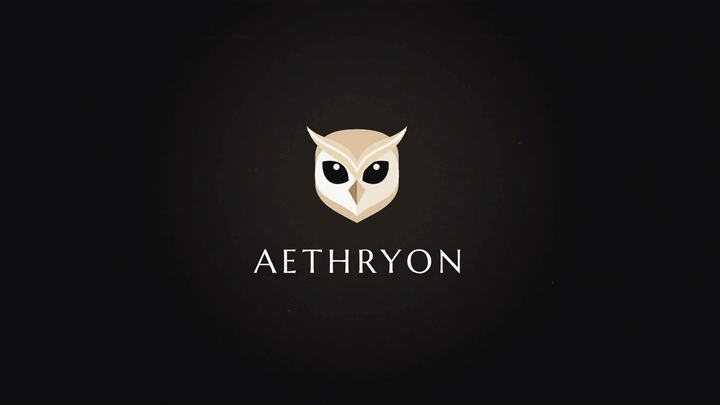
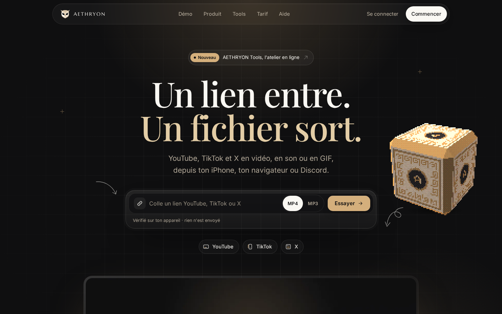
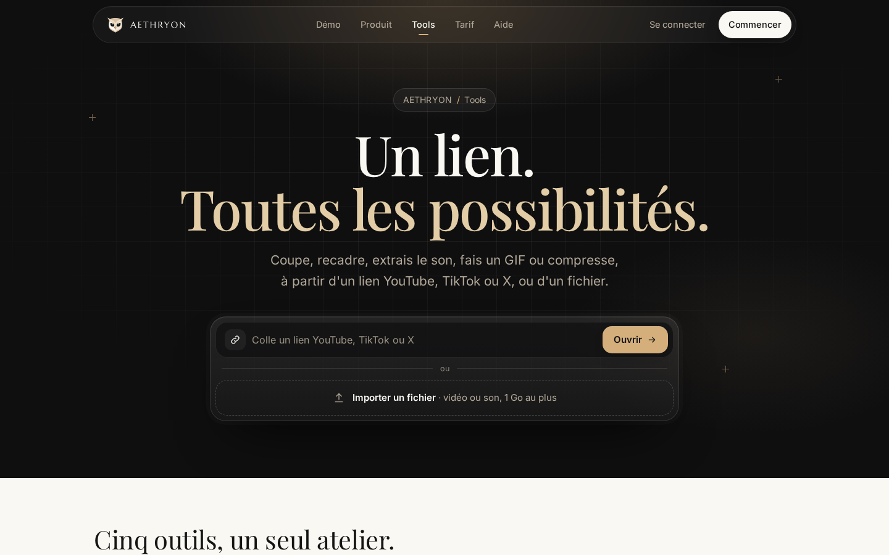
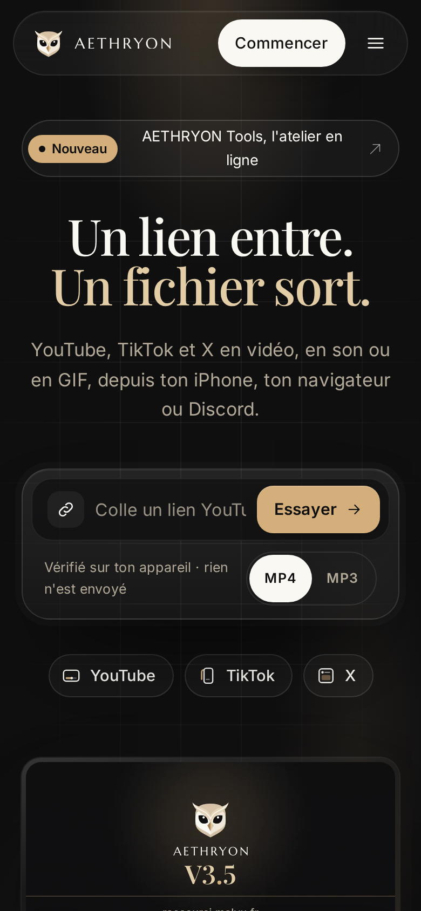
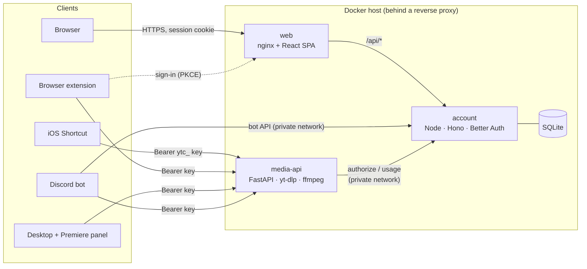

<!-- AETHRYON — README. GitHub-flavoured Markdown + the HTML subset GitHub allows (no custom CSS or JavaScript). -->

<p align="center">
  <a href="https://raccourci.malvu.fr">
    
  </a>
</p>

<p align="center">
  
</p>

<h3 align="center">Your media, within reach.</h3>

<p align="center">
  Paste a link, get a clean file — from your iPhone, your browser, Discord or your desktop,<br>
  with one account, one quota and one history.
</p>

<p align="center">
  <a href="https://raccourci.malvu.fr"></a>
  <a href="#-downloads"></a>
  <a href="#-downloads"></a>
  <a href="apps/discord-bot/README.md"></a>
  <a href="apps/desktop/README.md"></a>
</p>

<p align="center">
  
  
  
  
  
  
</p>

<p align="center">
  <a href="https://github.com/MALVEILLANCEMAX/aethryon/actions/workflows/ci.yml"></a>
  <a href="#-license"></a>
  <a href="https://buymeacoffee.com/malvoyance"></a>
</p>

<p align="center">
  <a href="https://raccourci.malvu.fr"><b>Website</b></a> ·
  <a href="#-downloads"><b>Downloads</b></a> ·
  <a href="docs/README.md"><b>Documentation</b></a> ·
  <a href="#-getting-started"><b>Run it locally</b></a> ·
  <a href="CONTRIBUTING.md"><b>Contributing</b></a> ·
  <a href="SECURITY.md"><b>Security</b></a>
</p>

<p align="center">
  <br>
  <sub>Excerpt from the official launch film · <a href="https://raccourci.malvu.fr/media/film/aethryon-v35-1080.mp4">watch the full 38-second film</a></sub>
</p>

---

<details>
<summary><b>Table of contents</b></summary>

- [What is AETHRYON?](#-what-is-aethryon)
- [Features](#-features)
- [Downloads](#-downloads)
- [See it in action](#-see-it-in-action)
- [Components](#-components)
- [Architecture](#-architecture)
- [Getting started](#-getting-started)
- [Roadmap](#-roadmap)
- [Contributing](#-contributing)
- [Security](#-security)
- [Responsible use](#-responsible-use)
- [Support the Project](#-support-the-project)
- [License](#-license)

</details>

## ◆ What is AETHRYON?

AETHRYON turns a public video link into a file you can keep: **MP4** video, **MP3** audio, a **clip**, a **GIF** or a
still **image**. It started as a single iPhone Shortcut and grew into a small ecosystem built around one account:

- the **website** to create your account, manage personal access keys, follow your activity and edit media in **AETHRYON Tools**;
- an **iOS Shortcut** that appears in the share sheet;
- a **browser extension** that adds an AETHRYON button next to the video you are watching;
- a **Discord bot** that answers privately in any conversation;
- **AETHRYON Desktop** and a **Premiere Pro panel** for Windows (beta).

Why it exists: getting a clean file out of a link should not require shady websites full of ads and trackers.
AETHRYON is ad-free, collects only what the service needs, and shows the real state of things — limits, errors and
quotas are spelled out instead of hidden.

> [!NOTE]
> The user interface of the apps is currently in **French**. Code, documentation and contributions are welcome in English.

## ◆ Features

<table>
  <tr>
    <td width="50%" valign="top">
      <b>One link, every format</b><br>
      MP4 (best available quality), MP3 (192 kbit/s by default), clips with start and end times, GIFs and still images.
    </td>
    <td width="50%" valign="top">
      <b>One account everywhere</b><br>
      Sign in with Google, e-mail or Discord. The Shortcut, the extension, the bot and Desktop share the same quota and history.
    </td>
  </tr>
  <tr>
    <td valign="top">
      <b>Personal access keys</b><br>
      <code>ytc_…</code> keys are generated server-side, shown once, stored as SHA-256 hashes, revocable at any time.
    </td>
    <td valign="top">
      <b>AETHRYON Tools</b><br>
      An online workshop to trim, crop, extract audio, make a GIF or compress — from a link or from your own file.
    </td>
  </tr>
  <tr>
    <td valign="top">
      <b>Precise clips (TimeLens)</b><br>
      The extension picks a passage around the playhead with frame-accurate controls and fetches only that range.
    </td>
    <td valign="top">
      <b>Honest by design</b><br>
      Strict Content Security Policy, no ads and no audience tracking, readable error codes and the availability of each platform shown in the app.
    </td>
  </tr>
</table>

Supported sources today: public **YouTube**, **TikTok** and **X** links (playlists and live streams are not supported).

## ◆ Downloads

| | Component | Version | Get it | Notes |
|:-:|---|---|---|---|
| 📱 | **iOS Shortcut** | 3.0 | [**Add from iCloud**](https://www.icloud.com/shortcuts/e1e2eaadf6c841bd884c9dbe680675d1) · [signed `.shortcut` file](https://raccourci.malvu.fr/downloads/AETHRYON.shortcut) · [in this repo](shortcuts/ios/dist/AETHRYON.shortcut) | Needs a personal key from your account. [Guide](shortcuts/ios/README.md) |
| 🧩 | **Browser extension** (Chrome, Edge, Brave) | 3.8.1 | [**Download the ZIP**](https://raccourci.malvu.fr/downloads/extension/aethryon-extension-3.8.1.zip) · [SHA256SUMS](https://raccourci.malvu.fr/downloads/extension/SHA256SUMS) · [install page](https://raccourci.malvu.fr/extension) | Manual install (developer mode), no store. [Guide](apps/extension/README.md) |
| 💬 | **Discord bot** | v2 | [**Add to my apps**](https://discord.com/oauth2/authorize?client_id=1558821698734923796&integration_type=1&scope=applications.commands) · [Add to a server](https://discord.com/oauth2/authorize?client_id=1558821698734923796&integration_type=0&scope=applications.commands+bot&permissions=274878286912) | Private replies by default. [Commands](apps/discord-bot/README.md) |
| 🖥️ | **AETHRYON Setup** (Desktop + Premiere Pro panel, Windows) | 2.0.0-beta.8 | [**Download the installer**](https://raccourci.malvu.fr/downloads/premiere/AETHRYON-Setup-2.0.0-beta.8.exe) · [SHA256SUMS](https://raccourci.malvu.fr/downloads/premiere/SHA256SUMS) | Beta. [Desktop](apps/desktop/README.md) · [Panel](apps/premiere-panel/README.md) |
| 🌐 | **Website** | — | [raccourci.malvu.fr](https://raccourci.malvu.fr) | Account, keys, activity, Tools |

> [!TIP]
> Always check a download against its `SHA256SUMS` file, and only download AETHRYON from the official website or from this repository's releases.

## ◆ See it in action

<p align="center">
  <br>
  <sub>The browser extension · excerpt from the official launch film</sub>
</p>

<table>
  <tr>
    <td width="50%"></td>
    <td width="50%"></td>
  </tr>
  <tr>
    <td align="center"><sub>Website — built from this repository</sub></td>
    <td align="center"><sub>AETHRYON Tools</sub></td>
  </tr>
</table>

<table>
  <tr>
    <td width="33%"></td>
    <td width="33%"></td>
    <td width="33%"></td>
  </tr>
  <tr>
    <td align="center"><sub>Extension popup</sub></td>
    <td align="center"><sub>TimeLens precise clips</sub></td>
    <td align="center"><sub>Website on mobile</sub></td>
  </tr>
</table>

<details>
<summary><b>Discord and iPhone demos</b></summary>

Screen recordings of the Discord bot in a real Discord client and of the Shortcut on a real iPhone are not available
yet. Rather than showing a staged imitation, their slots are documented in [`assets/README.md`](assets/README.md).
The [launch film](https://raccourci.malvu.fr/media/film/aethryon-v35-1080.mp4) shows both flows in motion design.

</details>

## ◆ Components

| Folder | What it is | Stack |
|---|---|---|
| [`apps/web`](apps/web/README.md) | Public website, personal space, Control Center, AETHRYON Tools | React 19, Vite, Tailwind CSS 4, nginx (pre-rendered pages, strict CSP) |
| [`apps/account`](apps/account/README.md) | Accounts, sessions, personal keys, quotas, billing, Discord linking | Node 22, Hono, Better Auth, SQLite |
| [`apps/media-api`](apps/media-api/README.md) | Conversion API used by every client | Python 3.12, FastAPI, yt-dlp, ffmpeg |
| [`apps/extension`](apps/extension/README.md) | Browser extension (Manifest V3) | TypeScript, esbuild |
| [`apps/discord-bot`](apps/discord-bot/README.md) | Discord bot (slash commands, message menu) | Node 22, discord.js 14 |
| [`apps/desktop`](apps/desktop/README.md) | AETHRYON Desktop for Windows (library, transfers, Premiere bridge) | Tauri 2, Rust, React |
| [`apps/premiere-panel`](apps/premiere-panel/README.md) | Premiere Pro panel (CEP) | Preact, Vite |
| [`apps/setup`](apps/setup/README.md) | Windows installer for Desktop and the panel | Tauri 2, Rust |
| [`shortcuts/ios`](shortcuts/ios/README.md) | iOS Shortcut sources (Cherri), validator and signed file | Cherri, Python |
| [`packages/brand`](packages/brand/README.md) | Master identity: owl, logotype, icons and generators | SVG, Python |
| [`docs`](docs/README.md) | Architecture, installation, API, security | Markdown |

## ◆ Architecture



Every client talks to the **media API** with a personal key; the media API asks **account** — over a private Docker
network — whether the key may create a job and reserves one unit of quota atomically. More in
[`docs/architecture`](docs/architecture/README.md).

## ◆ Getting started

**Prerequisites:** Docker with `docker-compose` (or `docker compose`), GNU Make, Node.js 22 and Python 3.11+ for the
unit tests. Rust is only needed for Desktop and Setup.

```bash
git clone https://github.com/MALVEILLANCEMAX/aethryon.git && cd aethryon
cp .env.example .env          # optional: ports and example settings
make dev-secrets              # random local secrets in .dev/secrets (never printed, git-ignored)
make dev-build                # web, account and media-api images
make dev-up                   # http://localhost:18110 (site) · http://127.0.0.1:18111 (media API)
```

The development stack is fully local: no reverse proxy, no production domain, and the media API runs a **fake
worker** that never contacts any platform. Google, Discord, Stripe, SMTP and S3 stay disabled until you provide your
own test credentials. Step-by-step guide: [`docs/installation/development.md`](docs/installation/development.md).

<details>
<summary><b>Run the tests</b></summary>

```bash
make test               # error catalogue, account, media-api (offline container), web build, extension, bot, panel
make test-desktop-core  # Rust core of Desktop (needs a Rust toolchain)
make test-shortcut      # checks the signed Shortcut: Apple chain, content, no secret
make scan               # secret scan of the working tree (gitleaks)
```

</details>

## ◆ Roadmap

| Status | Item |
|---|---|
| ✅ Live | Website and accounts (Google, e-mail, Discord), personal keys, quotas, activity |
| ✅ Live | iOS Shortcut 3.0, browser extension 3.8 (clips, GIF, images, TimeLens), Discord bot v2 |
| 🧪 Beta | AETHRYON Tools, AETHRYON Desktop and the Premiere Pro panel for Windows |
| 🔧 In progress | AETHRYON Cloud (temporary private storage) and legal music connectors — behind feature flags, off by default |
| 🔧 In progress | Premium plans — billing code is in place, sales are closed |
| 📝 Open source | English translations of code comments and internal docs (mostly French today), more contributor guides |
| 📝 Open source | Real-device demos for Discord and iPhone, Windows CI for Desktop and Setup |
| ⚖️ Pending | Choice of an open-source license by the owner (see [License](#-license)) |

## ◆ Contributing

Contributions are welcome: bug reports, documentation, translations, tests and code. Start with
[`CONTRIBUTING.md`](CONTRIBUTING.md), follow the [Code of Conduct](CODE_OF_CONDUCT.md), and open an issue before a
large change. Never include secrets, personal data or real user files in an issue or a pull request.

## ◆ Security

Please **do not** open a public issue for a vulnerability. Report it privately as described in
[`SECURITY.md`](SECURITY.md).

## ◆ Responsible use

AETHRYON is a tool for media **you own or are allowed to use**. Respect copyright and the terms of the platforms you
use. AETHRYON works on public links only (private videos, playlists and live streams are refused), does not host or
index content, does not handle DRM-protected media, and is not affiliated
with, endorsed or sponsored by YouTube, Google, TikTok, X, Discord, Apple or Adobe. All trademarks belong to their
owners. Details: [`docs/legal/responsible-use.md`](docs/legal/responsible-use.md).

## ◆ Support the Project

AETHRYON is built and hosted independently. If it saves you time, you can help cover hosting and development costs:

<p>
  <a href="https://buymeacoffee.com/malvoyance"></a>
</p>

Starring the repository, reporting bugs and improving the documentation help just as much. Thank you.

## ◆ License

> [!IMPORTANT]
> **No open-source license has been chosen yet.** Until the owner publishes a `LICENSE` file, all rights are
> reserved: you may read the code, but not reuse or redistribute it.

The AETHRYON name, the owl, the logotype and the other brand assets in [`assets/`](assets) and
[`packages/brand`](packages/brand) are **not** covered by the future code license. Third-party components keep their
own licenses (fonts: SIL Open Font License; see the `LICENSE-*.txt` files next to them).

<p align="center"><br>
  <br>
  <sub>AETHRYON · made in France · <a href="https://raccourci.malvu.fr">raccourci.malvu.fr</a></sub>
</p>
