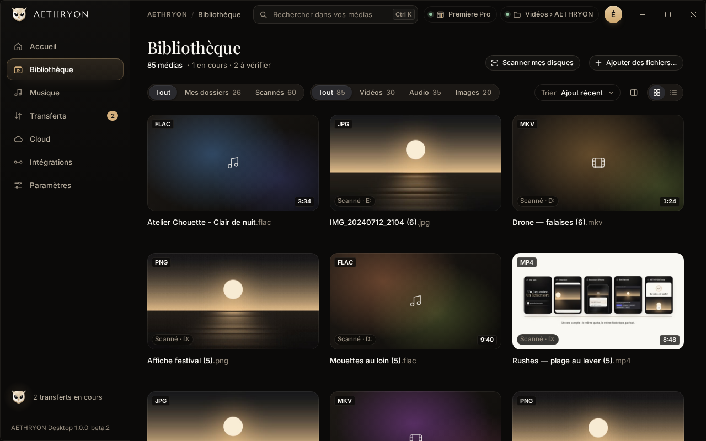

# AETHRYON Desktop (Windows, beta)

A Windows companion app: a media library that indexes your AETHRYON downloads and chosen folders, transfers announced
by the browser extension, one-click updates of the extension, and the bridge to the **Premiere Pro panel**.

Tauri 2 · Rust core (`noyau/`) · React · version **1.2.0-beta.2** · distributed inside AETHRYON Setup.

<p align="center">
  <br>
  <sub>Library view rendered in the browser test harness with sample data (Desktop 1.0.0-beta.2)</sub>
</p>

> [!WARNING]
> Beta software for Windows 10/11. The Rust core and the interface are tested on Linux (unit tests, browser harness,
> Wine); real-Windows testing is done by the maintainers before each release.

## Features

- **Library**: watched folders, cards or list, search, filters, preview player (timecode, frame by frame, J/K/L).
- **Transfers**: browser downloads detected in the media folder and transfers announced by the extension through
  Native Messaging.
- **Premiere Pro**: detects the installed version, imports media into the open project through the AETHRYON panel,
  repairs or removes the panel.
- **Updates**: checks `latest.json` on the website, verifies size and SHA-256, never installs without a click.
- **Settings**: theme, reduced motion, folders, notifications, start with Windows, local logs.

## Build and test

```bash
npm ci
npm test                         # interface tests (vitest)
npm run build                    # typecheck + vite build of the interface
cargo test -p aethryon-noyau -p aethryon-archive-extension    # Rust core and archive verification (Linux OK)
```

Building the Windows executable needs the Tauri prerequisites for Windows (or the cross-compilation script
`scripts/construire.sh`, which expects local build artefacts passed through environment variables).

## Layout

```
noyau/               portable Rust core: index, watcher, transfers, Native Messaging, updates (Windows parts behind cfg)
archive-extension/   verification of the browser-extension archive (shared with Setup)
src-tauri/           Tauri application (window, tray, notifications, bridge to the UI)
src/                 React interface
e2e/                 browser harness and screenshot scripts
essais-wine/         Wine checks used by the build script
```

Design notes in French: [`INDEX.md`](INDEX.md) (library index contract), [`FLUX.md`](FLUX.md) (drag and drop and
transfers). History: [`CHANGELOG.md`](CHANGELOG.md).
