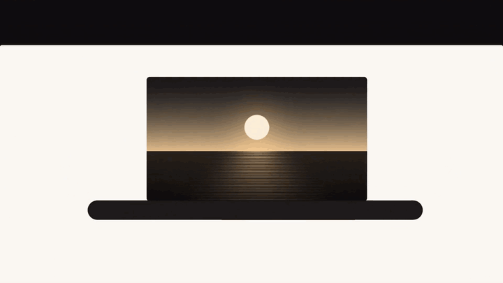
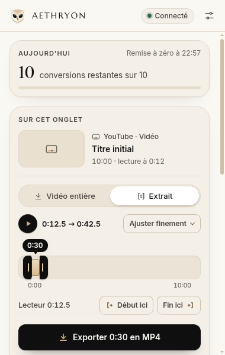
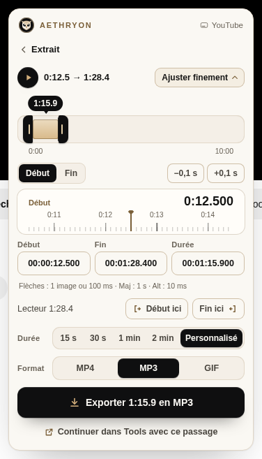

<p align="center"></p>

<h1 align="center">AETHRYON browser extension</h1>

<p align="center">
  An AETHRYON button next to the video you are watching: video, audio, clip, GIF or image in one menu.<br>
  Chrome · Microsoft Edge · Brave — Manifest V3 — version <b>3.9.0</b>
</p>

<p align="center">
  <br>
  <sub>Excerpt from the official launch film</sub>
</p>

<p align="center">
  
  
</p>

## Features

- **On YouTube, TikTok and X pages**: a discreet AETHRYON bar or button with *Download video (MP4)*,
  *Extract audio (MP3)*, *Quick clip*, *Video frame (PNG, made on your device)*, *Thumbnail* and
  *Continue in AETHRYON Tools*.
- **TimeLens clips**: choose a passage around the playhead with frame-accurate controls (± 0.1 s, keyboard shortcuts);
  only that range is fetched.
- **Popup**: today's remaining conversions, the media of the current tab, progress and results.
- **Send to Premiere Pro** (optional): hands the media to AETHRYON Desktop, which imports it into Premiere Pro.
- **Same account and quota** as the iOS Shortcut, the Discord bot and the website.

## Compatibility

| Browser | Status |
|---|---|
| Google Chrome **140+** (desktop) | Supported, tested in Chromium |
| Microsoft Edge 140+ | Supported (based on Edge documentation; not verified on a real Edge install) |
| Brave (current) | Supported (based on Brave documentation; not verified on a real Brave install) |
| Firefox, Safari, mobile browsers | Not supported |

## Install (manual, no store)

The extension is distributed directly, not through a store. Only download it from the official website or from
this repository's releases.

1. Download [`aethryon-extension-3.9.0.zip`](https://raccourci.malvu.fr/downloads/extension/aethryon-extension-3.9.0.zip)
   and [`SHA256SUMS`](https://raccourci.malvu.fr/downloads/extension/SHA256SUMS).
2. Check the archive: `sha256sum -c SHA256SUMS --ignore-missing` (Linux), `shasum -a 256 <zip>` (macOS) or
   `Get-FileHash .\<zip> -Algorithm SHA256` (Windows PowerShell).
3. Unzip it into a folder **you will keep** (the browser loads the extension from there at every start).
4. Open `chrome://extensions`, `edge://extensions` or `brave://extensions` and enable **Developer mode** (keep it on:
   since Chrome 134 an unpacked extension is disabled when developer mode is turned off).
5. Click **Load unpacked** and choose the folder that contains `manifest.json`.
6. Check the ID shown on the card: **`necpohicddjeaeaaomaakehcbccapabg`**. Another ID cannot sign in.
7. The welcome page explains how to pin the icon and shows the data notice. Nothing is sent to a server before you
   click **Accept**. Then **Sign in to AETHRYON** and approve the connection on the website.

**Update:** when the popup announces a new version, replace the folder's content with the new archive and click
**Reload** on the extension card. Sign-in and settings are kept. The extension never downloads or installs code by
itself.

**Uninstall:** sign out first (the key is revoked on the server), then remove the extension and delete the folder.

## Permissions

| Permission | Why |
|---|---|
| `storage` | Settings, consent and the extension key (local storage restricted to the extension's own pages) |
| `downloads` | Save the converted file |
| `identity` | Sign-in window on the AETHRYON website (OAuth-style flow with PKCE) |
| `alarms` | Follow conversion progress and check for new versions without keeping the service worker alive |
| `activeTab` | Capture the visible tab for *Video frame* when the page cannot provide the image itself (only after a click) |
| `notifications` (optional) | Notify when a conversion finishes, if you turn it on |
| `nativeMessaging` (optional) | Talk to AETHRYON Desktop for *Send to Premiere Pro*, requested when you choose it |
| Host access: the AETHRYON site and API only | Sign-in, quota, conversions, update notice |
| Content scripts on `youtube.com`, `tiktok.com`, `x.com` / `twitter.com` | Show the AETHRYON button on video pages |

No remote code: everything is packaged (`script-src 'self'`). No analytics.

## How it talks to the API

- Sign-in: `/extension/autoriser` on the website → an **extension key** bound to the extension ID.
- Conversions: the [media API](../../docs/api/README.md) with `Authorization: Bearer <key>`, exactly like the Shortcut.
- Update notice: `latest.json` on the website (`version`, `sha256`, `size`, `minChrome`, `notes`).

The production endpoints are compiled in `scripts/build.mjs` (environment variables cannot change them in a
production build). The development build targets the local stack (`AETHRYON_SITE`, `AETHRYON_API` can override it).

## Build from source

```bash
npm ci
npm run typecheck && npm test      # unit tests
npm run build                      # production build in dist/
npm run build:dev                  # development build in dist-dev/ (ID dnllfjakdgmgfiompaheickmbjjlgjdc)
npm run test:browser               # browser tests (Chromium, Playwright) — needs a local browser
```

### Reproducible releases

`node scripts/zip.mjs` writes `release/aethryon-extension-<version>.zip`, `SHA256SUMS` and `latest.json`. The ZIP is
**reproducible** (sorted entries, fixed dates and permissions): building version 3.9.0 from this repository gives the
same SHA-256 as the published archive (`8ee3023a…1c6a82`). Release notes come from [`CHANGELOG.md`](CHANGELOG.md).

Publishing a release is a maintainer decision: the archive is uploaded to the website by the maintainers, never by CI.

## Layout

```
src/background/   service worker: jobs, downloads, sign-in, updates, native messaging
src/content/      YouTube, TikTok and X integrations
src/popup/        toolbar popup
src/extrait/      TimeLens clip editor
src/options/      settings page
src/welcome/      first-run page and data notice
src/shared/       config, API client, brand, errors
tests/            unit, browser (Playwright), release and demo tests
```
