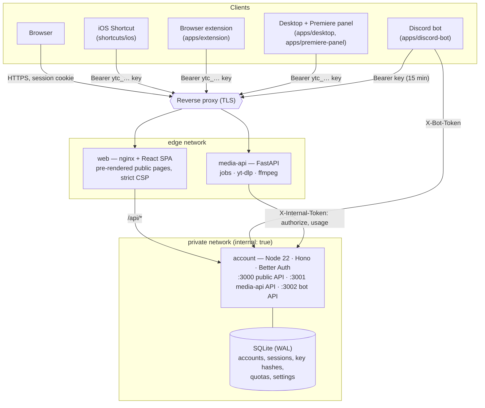

# Architecture

AETHRYON is a small set of services behind one reverse proxy, plus several clients that all use the same account.

## Services

| Service | Role | Exposed | Data |
|---|---|---|---|
| `web` | Serves the SPA and the pre-rendered public pages, proxies `/api/*` to account, serves the signed Shortcut and release files, sets security headers | port 8080 behind the reverse proxy | none |
| `account` | Sign-in (Google, e-mail, Discord), sessions, personal keys, quotas, history, admin Control Center, billing, Discord linking, device sign-in for Desktop and the Premiere panel | port 3000 through `web` only; 3001/3002 on the private network | SQLite file on a volume |
| `media-api` | Creates conversion jobs, downloads and converts media, serves the resulting files to their owner | port 8000 behind the reverse proxy | temporary files, deleted after `JOB_TTL_MIN` |
| `discord-bot` | Slash commands and message menu; talks to account (bot API) and to the media API | outbound only | none |

## Main flows

**Personal key.** A signed-in user calls `POST /api/keys`. account checks the per-user limit, generates
`ytc_` + 64 characters with Better Auth's API-key plugin, stores **only the SHA-256 hash**, and returns the secret
**once**. The interface shows it in a panel that can only be closed after copying; it is never written to browser
storage.

**Conversion.** A client sends `POST /jobs?wait=20` to the media API with `Authorization: Bearer ytc_…`. The media API
asks account (`authorize`, private network, short cache) whether the key may access the service; a per-user lock
joins an identical active job for free, refuses a second active job (`429 active_job_limit`), or asks account to
**reserve one unit of quota atomically** (`BEGIN IMMEDIATE`). Progress events are sent to account without URL or
title. Status and file downloads are only served to the job owner (others get `404`) and never consume quota.

**Extension sign-in.** The extension opens `/extension/autoriser` on the website (OAuth-style flow with PKCE through
`chrome.identity`); the user approves, and account issues an extension key bound to the extension ID allowed by
`EXTENSION_IDS`.

**Desktop and Premiere panel sign-in.** A device-authorization flow inspired by RFC 8628: the app shows a short code,
the user approves it on `/desktop/connecter` or `/premiere/connecter`, and the app receives a dedicated key.

**Discord.** Users link their Discord account with OAuth2 (`identify` scope) from the website. The bot calls account's
bot API (`X-Bot-Token`, private network) to resolve the linked account and obtain a short-lived key, then uses the
media API like any other client. Replies are private by default.

## Design choices

| Need | Choice | Why |
|---|---|---|
| Sign-in | Better Auth | Maintained, PKCE + state, secure cookies, origin checks, API-key plugin |
| Database | SQLite (WAL) | One host, low traffic, consistent backups with `VACUUM INTO`; no extra database server |
| Key validation | HTTP call from media-api to account on a private network | The media API never sees the database; revocation is immediate |
| Quotas | Reserved in account when a job is created | Survives restarts; the media API knows the real job state |
| Website | SPA + pages pre-rendered at build time + nginx | No rendering server; content readable without JavaScript; compatible with a strict CSP (no inline scripts or styles) |
| Secrets | Files mounted read-only (`*_FILE` variables) | Never in environment dumps, logs or images |

## Error codes

All user-facing errors share one catalogue: [`docs/api/ERREURS.md`](../api/ERREURS.md). `scripts/check-error-codes.py`
verifies that account, the media API and the bot use the same codes and texts.
