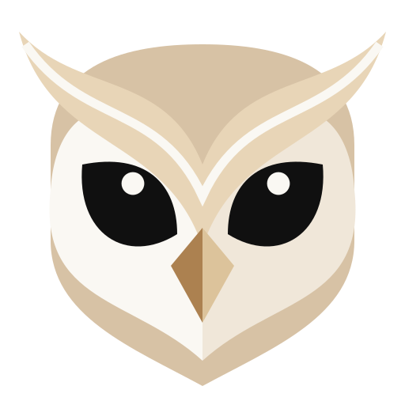
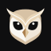

# AETHRYON brand sources

The **master identity** of AETHRYON: the owl head drawn from the owner's reference and the Marcellus logotype in
outlines. Every icon and logo used by the apps is generated from these files — never redrawn by hand.

  
  
  

| Path | Contents |
|---|---|
| `master/aethryon-master.svg` | the master owl head (64-unit grid) |
| `master/variantes/` | official variants: app icon, symbol, monochrome, horizontal and vertical lock-ups, favicon, Discord avatar |
| `master/png/` | PNG exports used by the extension, the apps and the README |
| `master/fonts/` | Marcellus, Cormorant Garamond, Geist (SIL Open Font License, licence files included) |
| `master/tools/export_web.py` | regenerates the brand modules of the website and the extension (`--check` verifies them) |
| `master/tools/build_variants.py` | regenerates the variants and PNG exports |

Palette: obsidian `#0F0F10`, night `#18181A`, graphite `#2A2A2E`, ivory `#FAF8F3`, pearl `#F4EFE7`, sand `#E9E0D0`,
antique gold `#D4AF7C`, light gold `#E3CDA6`.

## Usage rights

These assets are **not** covered by the code license. The AETHRYON name, the owl and the logotype identify the
official project: do not use them for another product, a fork you distribute, or anything that suggests an
endorsement. Forks must use their own name and logo.
